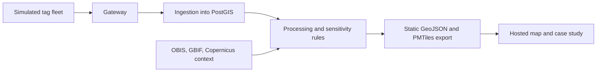

## prod_001_lorenzini_track_shark_telemetry_from_tag_to_map - Lorenzini Track: shark telemetry from tag to map
> Date: 2026-10-16
> Status: Proposed
> Related request: `req_000_lorenzini_track_1_0_public_showcase`
> Related backlog: `item_000_scope_reset_to_sharks_and_rename_to_lorenzini_track`, `item_001_simulated_shark_tag_fleet`, `item_002_gateway_ingestion_and_processing_pipeline_for_simulated_tags`, `item_003_telemetry_uncertainty_and_data_sensitivity_views`, `item_004_open_context_layers_with_a_dataset_licence_register`, `item_005_static_hosted_demo_build`, `item_006_case_study_readme_live_url_and_licence`
> Related task: (none yet)
> Related architecture: (none yet; see `docs/decisions/0001` to `0006`)
> Reminder: Update status, linked refs, scope, decisions, success signals, and open questions when you edit this doc.
> Indicators reviewed: 2026-10-19 15:53:27

# Overview
Lorenzini Track is an open research project on shark telemetry, from tag to map. It simulates a fleet of shark tags the way real tags behave, carries their data through a gateway, ingestion and processing pipeline like a real telemetry system, and publishes the result as a public map that shows where the data is uncertain and why some positions are deliberately coarsened. Stefano Lorenzini described in 1678 the ampullae of Lorenzini, the organs sharks use to sense faint electric fields; the project takes his name.

It is a portfolio showcase for the owner, an IoT engineer who cares about sharks and is aiming at work in marine-conservation tech. Its readers are people who hire or collaborate in that field: research groups running tagging programmes, conservation-tech teams, and engineers who build telemetry for them. They should come away seeing that the owner understands both sides: how tags, satellites, receivers and duty cycles produce imperfect data, and why shark locations have to be handled carefully.

Real shark tracking data is mostly access-restricted, and partly on purpose: precise, recent positions of threatened species can be used to harm them (`docs/decisions/0004-no-live-tracking-data.md`). So the tracks are simulated from published movement models and labelled as simulated everywhere. Open occurrence data (OBIS/GBIF) and environmental data (Copernicus Marine) give the real-world context.

1.0 headline: **a live demo link and a case-study README that walk a reader from a simulated tag on a shark's fin to a map that is honest about uncertainty and sensitivity.**

# What exists today (2026-10-16)
- Backend: FastAPI + SQLAlchemy/GeoAlchemy2 + Alembic over PostGIS (three migrations). Tables `study` and `occurrence` (Darwin Core column names). Routes: health, occurrences (GeoJSON), studies, species (with histograms and centroids), and a server-side proxy for EMODnet bathymetry tiles.
- Ingestion: pluggable readers (STAT/GBIF Darwin Core archives, a streamed IMOS ATF acoustic reader, a CSV reader) feeding a shared loader. Eleven datasets across five taxa: whale, basking, lemon, tiger, bull and reef sharks, plus devil ray, green and leatherback turtles, grey seal, manatee and Anguilla seabirds. `app/data/species_facts.py` holds curated facts for 19 species.
- Frontend: React 19 + Vite + MapLibre GL JS. Species and study panels, per-organism track lines with hover highlight, time filter, records-by-year chart, species profiles with Wikimedia photos and size diagrams, taxon-family colours, undersea POI markers, dark mode. Design-system notes in `design-system/lorenzini-track/MASTER.md` (formerly `design-system/poseidon/`).
- Docs: research phase (`docs/research/00` to `07`), six decision records (`docs/decisions/0001` to `0006`); `docs/learning/` has topic folders but no notes yet.
- Not built: simulation, uncertainty display, sensitivity handling, environmental layers, hosting, licence file. The README still says "codename poseidon" and "no ingestion implemented".
- Checks: `vite build` and `oxlint` pass; `tsc -b` fails with two errors in `MapView.tsx`; backend tests need a live PostGIS (not run here); `ruff check` has 27 findings.

# What to cut or rework
- Keep, behind sharks (owner decision 2026-10-19, `docs/decisions/0008-sharks-lead-other-species-kept.md`, replacing the 2026-10-16 cut): the non-shark taxa (devil ray, turtles, seal, manatee, seabirds) with their ingestion scripts, facts, colours and media, reachable through a taxon-family filter that opens on sharks; taxon-family colouring; the undersea feature-name layer (sea map detail). Land detail stays as is for now; the owner will judge it later.
- Cut: the 20k point caps and sampling (uncapped until tiles arrive in 0.5).
- Rework: the backend bathymetry proxy (a static site cannot proxy; use a pre-built or CORS-friendly layer), "study exploration" (becomes tag deployments plus context datasets), the whale shark 1° aggregated "tracks" (they are gridded occurrences, not tracks; keep as context only), IMOS acoustic detections (real shark positions at receiver stations; keep only under the sensitivity rules, or drop), species profiles (one short card per featured shark species, every photo with its licence and author).
- Rename: `poseidon` in README, `pyproject.toml`, FastAPI title, `docker-compose.yml`, `index.html`, `Header.tsx`, the theme localStorage key and `design-system/poseidon/`.

# Goals
- A simulated tag fleet that behaves like real tags: movement from published shark movement models; satellite fixes only when the fin breaks the surface, with Argos location classes; acoustic detections only near receivers, with detection probability falling with range; duty cycles, battery drain, transmission gaps and tag failure.
- A pipeline that looks like real telemetry engineering: tag messages → gateway (decode, deduplicate, timestamp) → ingestion into PostGIS → processing (quality filtering, track reconstruction, sensitivity rules) → static export.
- Uncertainty that a visitor can see: error ellipses or radii per Argos class, acoustic detections drawn as receiver ranges rather than points, gaps shown as gaps.
- Data sensitivity as a feature: precision levels, delayed publication, and coarsened positions by conservation status, applied to every layer that shows animal positions, with an in-product explanation of why.
- A static hosted demo (pre-processed GeoJSON/PMTiles on GitHub Pages or Cloudflare Pages) that costs nothing to keep online.
- A case-study README that explains the problem, the design choices and the limits, opening with "Lorenzini Track: an open research project on shark telemetry, from tag to map".

# Non-goals
- Live or near-live animal positions (`docs/decisions/0004`).
- Presenting simulated data as real, or mixing it with real tracks without a label.
- An installable product, user accounts, uploads or a hosted API in 1.0.
- New features for taxa other than sharks: they stay browsable as they are, but the simulator, pipeline, uncertainty views and case study are about sharks.
- Habitat-suitability modelling, 3D/depth views and conservation dashboards in 1.0.
- Gimmicky copy: the name and the Lorenzini line are the only nod to the theme.

# Scope and guardrails
- In: sharks-first view (other species behind a taxon filter) and rename; tag simulator; gateway, ingestion and processing; uncertainty and sensitivity views; OBIS/GBIF occurrence context and one Copernicus Marine variable; dataset licence register; static export and hosting; case-study README; LICENSE.
- Out: new non-shark features, live data, accounts, server hosting, hardware (1.1), real restricted datasets (1.2).
- Guardrail: every simulated feature carries a visible "simulated" label in the UI and in exported files (`docs/decisions/0005`).
- Guardrail: no dataset is published in the demo before its licence is checked and recorded in the register, with attribution shown in the map.
- Guardrail: the sensitivity rules apply to real positions too (IMOS detections, occurrence records), not only to simulated ones.
- Guardrail: FastAPI + PostGIS remain the ingestion and processing side; the public demo never calls them.
- Guardrail: new ideas go to 1.1 or later unless they block a 1.0 exit signal.

# Key product decisions
- 2026-08-17: layered explorer with a simulated-telemetry companion (`docs/decisions/0001-product-direction.md`).
- 2026-08-17: Ningaloo whale shark GBIF 1° aggregated data as an interim flagship (`docs/decisions/0002-flagship-track-dataset.md`); superseded by the simulated fleet (`docs/decisions/0007-lorenzini-track-framing.md`).
- 2026-08-17: decoupled React + FastAPI, OpenFreeMap basemap, SQLAlchemy/GeoAlchemy2/Alembic (`docs/decisions/0003-frontend-backend-architecture.md`); the deployable frontend becomes a static site reading files, not the API.
- 2026-08-17: no live tracking data, by design (`docs/decisions/0004-no-live-tracking-data.md`).
- 2026-08-17: simulated telemetry promoted to a primary showcase, always labelled (`docs/decisions/0005-study-exploration-and-iot-showcase-refinement.md`).
- 2026-08-17: Manx basking shark watch as a second study (`docs/decisions/0006-second-study-dataset.md`).
- 2026-10-16: licence MIT for code, CC BY 4.0 for docs and simulated data; the demo is non-commercial because of CC BY-NC inputs, and the README says so.
- 2026-10-16: featured fleet is scalloped hammerhead off eastern Australia (critically endangered; realistic acoustic receiver arrays in that region).
- 2026-10-16: real IMOS acoustic detections are left out of 1.0; 1.0 shows simulated tracks plus occurrence context. Real data comes with 1.2.
- 2026-10-16: two transport networks, to show different tracker technologies: satellite tags deliver in batches in the style of Argos, and near-real-time trackers and receivers publish over MQTT (Mosquitto). This revises the "no message bus" line in `docs/decisions/0001`; record it in a new decision record.
- 2026-10-16: species profiles and photos stay for now (revisited when the demo takes shape).
- 2026-10-16: hosting on GitHub Pages; a personal domain comes later and will host the owner's resume and all projects, this demo included.
- 2026-10-16 (owner): name Lorenzini Track; portfolio showcase; 1.0 is a live demo plus a case-study README; shark-only scope reset (replaced on 2026-10-19, see below); simulated tag fleet is the core; OBIS/GBIF and Copernicus Marine as context with recorded licences; data sensitivity as a feature; static hosting; post-1.0 a tag/edge device, then one real dataset through a research group.
- 2026-10-19 (owner): sharks lead, other species stay. Sharks are the headline story, the default map and list view and the simulated fleet; the other species stay in the data and the UI behind a taxon-family filter, and nothing species-related is deleted. The undersea feature-name layer stays as sea map detail; land detail is left for a later owner review. Occurrence points stay uncapped until tiles arrive in 0.5 (`docs/decisions/0008-sharks-lead-other-species-kept.md`).

# Dataset licences (to verify in item_004)
- Ningaloo Outlook whale shark tracking, GBIF 1° aggregated: CC BY-NC 4.0 (`docs/decisions/0002`).
- Manx Basking Shark Watch 2017-2018: CC BY-NC 4.0 (`docs/decisions/0006`).
- IMOS ATF acoustic tracking: recorded as CC BY 4.0 in `backend/app/ingestion/imos_sharks.py`; not yet checked against the source.
- OBIS/GBIF occurrence records: per-record licences (CC0, CC BY, CC BY-NC); must be kept per record.
- Copernicus Marine products: free and open under the Copernicus Marine licence, with attribution; exact wording per product to record.
- EMODnet Bathymetry, OpenFreeMap/OpenStreetMap basemap, Wikimedia photos: licence and attribution per source still to record.
- Non-shark datasets (devil ray, green and leatherback turtles, grey seal, manatee, Anguilla seabirds; OBIS-SEAMAP/GBIF archives): licence per dataset, still to record; they stay in the demo (decision 0008), so the register covers them too.
- Consequence: CC BY-NC inputs make the demo non-commercial; that fits a portfolio, and the README must say so.

# Success signals
- A reader who has never seen the project understands from the demo, in under five minutes, why a shark track has gaps, why some fixes are uncertain and why some positions are coarsened.
- The demo runs from a static host with no backend and stays up without maintenance.
- The pipeline runs end to end locally from one documented command, and tests cover the simulator and processing logic.
- After 1.0: the demo is used to open a conversation with at least one research group about one real dataset (1.2).

# Open questions
- None after the 2026-10-16 owner review (see Key product decisions).

# References
- Product back-reference: `req_000_lorenzini_track_1_0_public_showcase`
- Roadmap: `road_001_lorenzini_track_to_1_0`
- Task back-reference: (none yet)
- Internal: `docs/research/00-summary-and-recommendations.md`, `docs/research/06-scientific-considerations.md`, `docs/decisions/`
- External: https://oceantrackingnetwork.org/addressing-concerns-in-the-misuse-of-animal-tracking-data/
