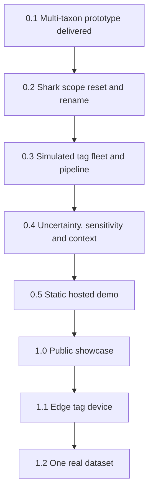

## road_001_lorenzini_track_to_1_0 - Lorenzini Track to 1.0
> Date: 2026-10-16
> Status: Proposed
> Related product: `prod_001_lorenzini_track_shark_telemetry_from_tag_to_map`
> Related request: `req_000_lorenzini_track_1_0_public_showcase`
> Reminder: Update status, milestone scope, linked refs, risks, and success signals when you edit this doc.

# AI Context
- Summary: Roadmap for Lorenzini Track (codename poseidon) from a multi-taxon marine explorer prototype to a public 1.0 portfolio showcase: shark-only scope, simulated tag fleet and pipeline, uncertainty and sensitivity views, static hosted demo, case-study README; then a tag/edge device and one real dataset.
- Keywords: roadmap, milestones, versions, lorenzini track, sharks, telemetry, simulation, argos, acoustic, sensitivity, pmtiles, static demo, 1.0
- Use when: Planning or sequencing versions for Lorenzini Track.
- Skip when: You need execution details for a single backlog item; open the item instead.

# Summary
Owner framing decided 2026-10-16 (see the product brief): Lorenzini Track is a portfolio showcase, and 1.0 is a live demo link plus a case-study README, not an installable product. Today (0.1) the repo is a broad marine-wildlife explorer over PostGIS with eleven real datasets across five taxa, no simulation, no uncertainty display and no hosting. Ordering: cut to sharks and rename first so every later piece serves one story; then build the simulated tag fleet and the pipeline, which are the core of the showcase; then the views that make uncertainty and sensitivity visible, with open context layers; then the static export and hosting; then the case study. Scope freeze once accepted: new ideas go to 1.1 or later unless they block a 1.0 exit signal.

# Milestones
## 0.1 - Multi-taxon explorer prototype (delivered)
- Goal: Learn the domain and prove a PostGIS-backed map explorer end to end.
- Scope: Research phase and decisions 0001 to 0006; FastAPI + SQLAlchemy/GeoAlchemy2 + Alembic over PostGIS; Darwin Core `study`/`occurrence` model; pluggable ingestion readers and a shared loader; eleven datasets across sharks, rays, turtles, seals, manatees and seabirds; React + MapLibre UI with species and study panels, tracks, time filter, species profiles and dark mode; EMODnet bathymetry via a backend proxy.
- Exit signal: Met in part (2026-10-16): `vite build` and `oxlint` pass; `tsc -b` fails with two errors in `MapView.tsx`; backend tests need a live PostGIS and were not run.

## 0.2 - Shark scope reset and rename
- `item_000_scope_reset_to_sharks_and_rename_to_lorenzini_track`: Scope reset to sharks and rename to Lorenzini Track
- Goal: The repository tells one story, shark telemetry, under its real name, on a green baseline.
- Scope: Remove non-shark taxa (ingestion scripts, species facts, colours, media); remove undersea POI markers and point caps; rename `poseidon` in code, config, compose and docs; README rewritten to the new framing (case-study detail waits for 1.0); a new decision record that supersedes the interim flagship in 0002 and records the 2026-10-16 framing; fix the two `tsc -b` errors; backend tests runnable against a disposable PostGIS (compose or testcontainers) and green; ruff clean.
- Exit signal: `grep -ri poseidon` finds only history and the local folder name, `npm run build` passes, backend tests pass against a fresh database, and the map shows sharks only.

## 0.3 - Simulated tag fleet and pipeline
- `item_001_simulated_shark_tag_fleet`: Simulated shark tag fleet
- `item_002_gateway_ingestion_and_processing_pipeline_for_simulated_tags`: Gateway, ingestion and processing pipeline for simulated tags
- Goal: A reproducible fleet of simulated tags produces realistic raw telemetry that flows through a gateway, ingestion and processing into PostGIS.
- Scope: Movement from published shark movement models (behavioural-state random walks, with parameters cited); a seeded fleet of fin-mounted satellite tags and acoustic tags; satellite fixes only at surfacing, with Argos location classes and their error; acoustic detections near a receiver array with range-dependent detection probability; duty cycles, battery drain, transmission gaps and failure; raw messages in tag- and receiver-like formats; a gateway that decodes, deduplicates and timestamps; ingestion into a telemetry schema (deployments, raw fixes, detections) next to the Darwin Core tables; processing with a speed/quality filter and track reconstruction; every record flagged as simulated; one command runs it end to end; unit tests for the simulator and the processing logic.
- Exit signal: One command generates the fleet from a seed and loads it; the same seed gives the same output; the processed tracks show gaps and per-class error distributions consistent with the cited sources.

## 0.4 - Uncertainty, sensitivity and context
- `item_003_telemetry_uncertainty_and_data_sensitivity_views`: Telemetry uncertainty and data-sensitivity views
- `item_004_open_context_layers_with_a_dataset_licence_register`: Open context layers with a dataset licence register
- Goal: A visitor sees how uncertain each position is, why some positions are coarsened or delayed, and what the environment looked like.
- Scope: Argos-class error radii or ellipses; acoustic detections drawn as receiver ranges; gaps drawn as gaps; a raw vs processed toggle; sensitivity rules (precision levels, publication delay, coarsening by IUCN status) applied in processing to every animal-position layer, with an in-product explainer citing `docs/decisions/0004`; OBIS/GBIF shark occurrences as context with a sampling-effort caveat; one Copernicus Marine variable (sea surface temperature) for the fleet's region and period; a licence register covering every dataset, photo and basemap, with attribution in the map.
- Exit signal: Each position on the map can explain its own precision and sensitivity level, and every visible layer has a licence entry and an on-map attribution.

## 0.5 - Static hosted demo
- `item_005_static_hosted_demo_build`: Static hosted demo build
- Goal: The demo runs from a static host with no backend.
- Scope: An export step from PostGIS to GeoJSON and PMTiles (sensitivity rules already applied); the frontend reads static files through a data-source switch, keeping the API mode for local work; a static replacement for the bathymetry proxy; CI that builds and deploys to GitHub Pages or Cloudflare Pages; file-size and load-time budget.
- Exit signal: The deployed URL loads in under five seconds on a normal connection with the backend stopped, and a CI run rebuilds and redeploys it.

## 1.0 - Public showcase
- `item_006_case_study_readme_live_url_and_licence`: Case-study README, live URL and licence
- Goal: A stranger reads the README, opens the live link and understands the project and the owner's engineering choices.
- Scope: README opening with "Lorenzini Track: an open research project on shark telemetry, from tag to map" and one line on Stefano Lorenzini (1678, ampullae of Lorenzini); case study (problem, why simulated, tag-to-map architecture, uncertainty and sensitivity, limits, what is next); screenshots or a short capture; live URL in the README and the GitHub "About" field; LICENSE (MIT proposed for code, CC BY 4.0 for docs and simulated data; owner confirms); third-party data licences and the non-commercial note; repo description and topics.
- Exit signal: Tag `v1.0.0`; the README and the live demo are public; a reviewer outside the project can answer "what is simulated, what is real, and why" from them alone.

## 1.1 - Edge tag device
- Goal: Show the hardware side: a tag or edge device that produces the same messages as the simulator.
- Scope: A simulated firmware model or a dev-board prototype (e.g. a microcontroller with a GNSS module and a saltwater-switch stand-in) with a duty-cycled transmit loop and a battery budget; its messages go through the existing gateway unchanged.
- Exit signal: Messages from the device appear in the pipeline and the demo next to the simulated fleet, labelled by source.

## 1.2 - One real dataset
- Goal: Use the demo to approach a research group and process one real dataset under their terms.
- Scope: A short outreach pack (demo, case study, sensitivity rules); a data-sharing agreement; ingestion of one real dataset through the same pipeline, with the group's embargo and precision rules applied before anything is published.
- Exit signal: One real dataset is processed under a written agreement, and anything published follows the group's rules.

# Sequencing
- Deliver milestones in ascending version order unless dependencies force a documented exception.
- 0.2 gates everything: no new features on top of non-shark scope, a red type-check or tests that cannot run.
- In 0.3, item_001 defines the raw message formats; item_002 starts once those formats are fixed.
- item_004's licence register can start any time and must be complete before 0.5 publishes anything.
- The sensitivity rules in item_003 run in processing, not only in the UI, so the 0.5 export never contains full-precision restricted positions.
- The README case study waits for 0.5 so screenshots show the final look.
- Keep each increment independently reviewable, covered by unit tests for pure logic, and linked to concrete workflow docs.

# Risks
- A simulation can look fake or, worse, look real: cite every model parameter, label everything simulated, and validate against published error and gap statistics.
- Real positions (IMOS detections, occurrence records) can be sensitive too; publishing them unfiltered would contradict the project's own message.
- CC BY-NC inputs limit reuse; attribution and the non-commercial note must be visible.
- Static hosting limits: per-file size caps and HTTP range support for PMTiles must be checked on the chosen host; the current bathymetry proxy has no static equivalent yet.
- Scope creep from the broad 0.1 prototype: the cut in 0.2 must actually remove code, not hide it.
- Version labels are planning targets, not release promises.

# References
- Product brief(s): `prod_001_lorenzini_track_shark_telemetry_from_tag_to_map`
- Request(s): `req_000_lorenzini_track_1_0_public_showcase`
- Backlog item(s): see milestones
- Task(s): (none yet)
- Decision records: `docs/decisions/0001-product-direction.md` to `docs/decisions/0006-second-study-dataset.md`
